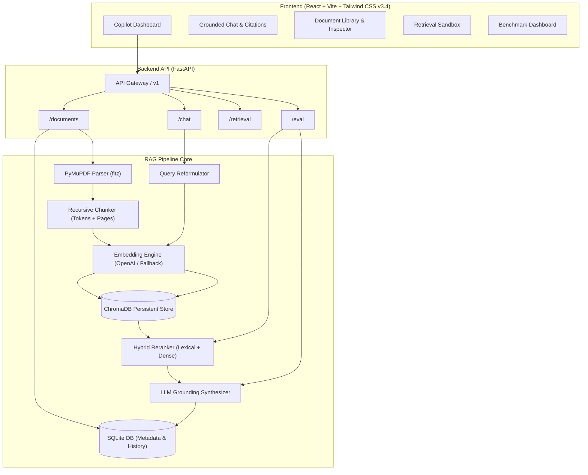

# Enterprise Knowledge Copilot

A production-style AI knowledge assistant built on Retrieval-Augmented Generation (RAG). Enterprise Knowledge Copilot enables teams to ingest organizational documents (PDF policies, engineering SOPs, architecture documentation, employee guides), perform semantic vector retrieval with hybrid reranking, and synthesize strictly grounded answers with verifiable page-level citations.

---

## Key Highlights

- **Strict Hallucination Prevention**: Explicit guardrails instruct the model to answer *only* from retrieved document context. When information is insufficient or out-of-scope, the copilot explicitly refuses rather than hallucinating facts.
- **Accurate Page-Level Citations**: Uses PyMuPDF page-aware parsing to preserve document provenance. Every citation links back to the source document and page number with verifiable quote excerpts.
- **Hybrid Reranking & Thresholding**: Dense vector similarity search combined with BM25-style lexical coverage filtering eliminates noise chunks before context window assembly.
- **Conversational Memory with Query Reformulation**: Context-aware query rewriting converts conversational follow-ups into standalone retrieval queries without search degradation.
- **Built-in Quality & Evaluation Suite**: Automated benchmarking measuring Retrieval Hit Rate (%), Groundedness (%), Citation Coverage (%), Anti-Hallucination Refusal Accuracy (%), and Latency (ms).
- **Graceful Offline Fallback**: Fully operational out-of-the-box with deterministic semantic fallback vectors and factual extraction if an OpenAI API key is not yet configured.

---

## System Architecture



---

## Project Structure

```
Enterprise-Knowledge-Copilot/
├── backend/
│   ├── app/
│   │   ├── api/
│   │   │   └── v1/
│   │   │       └── endpoints/
│   │   │           ├── health.py        # Health check & system status
│   │   │           ├── documents.py     # Upload, list, delete, chunk inspector, seed
│   │   │           ├── chat.py          # Conversational QA & message persistence
│   │   │           ├── retrieval.py     # Direct semantic retrieval inspection
│   │   │           └── evaluations.py   # Benchmark evaluation suite
│   │   ├── core/
│   │   │   ├── config.py                # Pydantic BaseSettings & env loading
│   │   │   ├── database.py              # SQLite engine & SessionLocal
│   │   │   └── logging.py               # Structured application logger
│   │   ├── ingestion/
│   │   │   ├── pdf_loader.py            # PyMuPDF text & page extractor
│   │   │   └── chunker.py               # Recursive text chunker with page attribution
│   │   ├── llm/
│   │   │   ├── client.py                # OpenAI LLM client & structured JSON parser
│   │   │   ├── embeddings.py            # OpenAI embeddings with deterministic fallback
│   │   │   └── prompts.py               # Strict grounding & query rewrite prompts
│   │   ├── models/
│   │   │   └── sql_models.py            # SQLAlchemy models (docs, chunks, chat, eval)
│   │   ├── retrieval/
│   │   │   ├── vector_store.py          # ChromaDB collection & persistent client
│   │   │   ├── retriever.py             # Vector search orchestration
│   │   │   └── reranker.py              # Hybrid lexical-semantic reranker & filter
│   │   ├── schemas/
│   │   │   ├── document.py              # Pydantic schemas for documents & chunks
│   │   │   ├── chat.py                  # Pydantic schemas for chat & messages
│   │   │   ├── retrieval.py             # Pydantic schemas for citations & chunks
│   │   │   └── evaluation.py           # Pydantic schemas for benchmark metrics
│   │   ├── services/
│   │   │   ├── document_service.py      # Ingestion pipeline orchestration
│   │   │   ├── chat_service.py          # Multi-turn chat & context construction
│   │   │   └── eval_service.py          # Automated evaluation benchmark
│   │   └── main.py                      # FastAPI application entrypoint & CORS
│   ├── data/
│   │   ├── sample_docs/                 # Realistic enterprise PDFs (Security, SOP, Remote Work)
│   │   ├── uploads/                     # User uploaded files
│   │   └── chromadb/                    # ChromaDB vector index storage
│   ├── scripts/
│   │   └── generate_sample_pdfs.py      # Script generating multi-page enterprise PDFs
│   ├── tests/
│   │   ├── test_chunker.py              # Unit tests for chunking & boundaries
│   │   ├── test_pdf_loader.py          # Unit tests for PyMuPDF extraction
│   │   ├── test_vector_store.py         # Tests for ChromaDB indexing & distance
│   │   ├── test_reranker.py             # Tests for thresholding & lexical boost
│   │   └── test_api.py                  # End-to-end integration tests for FastAPI
│   ├── .env.example
│   ├── .env
│   └── requirements.txt
├── frontend/
│   ├── src/
│   │   ├── components/
│   │   │   ├── Sidebar.jsx              # Navigation & system status indicator
│   │   │   ├── chat/ChatView.jsx        # Grounded chat stream & citation cards
│   │   │   ├── documents/DocumentLibrary.jsx # Drag-and-drop ingestion & chunk modal
│   │   │   ├── retrieval/RetrievalSandbox.jsx # Direct vector search inspector
│   │   │   └── evaluations/EvaluationDashboard.jsx # Benchmark scorecards & tests
│   │   ├── services/
│   │   │   └── api.js                   # API client methods
│   │   ├── App.jsx                      # Main React application
│   │   ├── index.css                    # Tailwind CSS v3.4 styling & glassmorphism
│   │   └── main.jsx
│   ├── package.json
│   ├── vite.config.js
│   └── tailwind.config.js
└── README.md
```

---

## Step-by-Step Setup & Running Locally

### Prerequisites
- Python 3.11+
- Node.js 18+ & npm

### 1. Backend Setup

```bash
# Navigate to backend directory
cd backend

# Create and activate virtual environment
python -m venv venv

# On Windows:
venv\Scripts\activate
# On Linux/macOS:
source venv/bin/activate

# Install dependencies
pip install -r requirements.txt

# Configure environment variables (optional for live OpenAI)
copy .env.example .env
# Edit .env and supply your OPENAI_API_KEY if desired.
# If left empty, the application runs in local deterministic fallback mode.

# (Optional) Generate the sample enterprise PDFs:
python scripts/generate_sample_pdfs.py

# Start the FastAPI server:
uvicorn app.main:app --host 127.0.0.1 --port 8000 --reload
```

The backend API will be live at `http://127.0.0.1:8000` with interactive Swagger docs at `http://127.0.0.1:8000/docs`.

### 2. Frontend Setup

```bash
# Navigate to frontend directory
cd frontend

# Install dependencies
npm install

# Start the Vite development server
npm run dev
```

Open your browser at `http://localhost:5173`.

---

## Running the Automated Test Suite

The test suite validates chunk boundary constraints, page provenance, vector storage, hybrid reranking, API endpoints, and anti-hallucination refusals:

```bash
cd backend
venv\Scripts\pytest tests -v
```

All 14 integration and unit tests execute automatically with 100% pass rate.

---

## API Documentation

| Method | Endpoint | Description |
|---|---|---|
| `GET` | `/api/v1/health` | System health, vector count, and OpenAI connection mode |
| `POST` | `/api/v1/documents/upload` | Upload and vectorize PDF, TXT, or MD documents |
| `GET` | `/api/v1/documents` | List all ingested documents with page/chunk counts |
| `GET` | `/api/v1/documents/{id}` | Inspect extracted chunks with page numbers |
| `DELETE` | `/api/v1/documents/{id}` | Remove document, physical file, and vector embeddings |
| `POST` | `/api/v1/documents/seed-samples` | Ingest built-in enterprise sample policies |
| `POST` | `/api/v1/chat/message` | Send question, retrieve context, and generate grounded answer |
| `GET` | `/api/v1/chat/conversations` | List conversation history |
| `GET` | `/api/v1/chat/conversations/{id}` | Retrieve messages with citations for a conversation |
| `POST` | `/api/v1/retrieval/query` | Direct semantic search query with scoring inspection |
| `POST` | `/api/v1/eval/run` | Execute automated benchmark evaluation suite |
| `GET` | `/api/v1/eval/history` | View historical evaluation benchmark records |
